<div align="center">

# @eboye/vue-grid

**A fast, accessible data grid for Vue 3 — built on CSS Grid, themed with CSS variables, tree-shakeable.**


[▶ Watch the full-quality video (MP4, 43 s)](docs/media/showcase.mp4) ·
[Examples cookbook](docs/examples.md) ·
[API reference](packages/vue-grid/README.md) ·
[Storybook](#documentation)

</div>

---

## Why vue-grid

- **Native layout, not a table emulation.** Rows are CSS Grid; nested rows use real `subgrid`, so
  children line up with their parent's columns at any depth — no width syncing in JavaScript.
- **CSS first.** Sticky pinned columns, pin shadows, popover menus anchored with CSS anchor
  positioning, `light-dark()` theming, native `<details>` disclosures. JavaScript only fills in
  where a browser lacks a feature — see [Browser support](#browser-support).
- **Small by default, everything optional.** ESM, one file per module, zero runtime dependencies.
  Sorting, filtering, server data, pagination, selection, sub-grids, menus, column reordering,
  resizing, pinning, visibility and grouping, pinned rows, totals, virtual scrolling and keyboard navigation are opt-in **features**, and
  renderers are opt-in too. A plain grid with text cells is **13.2 kB gzipped**, and each feature or renderer you add costs
  only itself.
- **Fast where it counts.** Virtual scrolling renders a screenful out of tens of thousands of rows,
  expanded sub-grids and detail rows included. Data changes re-render only the cells that changed,
  and the change highlight animates on the GPU. Filtering, sorting and value lists are built for
  big data. See [Performance](#performance).
- **Phones, tablets and touch.** The grid scrolls inside its own frame at any width (it never
  pushes the page sideways), swipes scroll it, holding a header picks the column up to drag it,
  and holding a header or cell opens its menu (iOS included, which has no right click). Inputs
  are 16 px on touch screens so iOS doesn't zoom, and tapped rows don't stay tinted. Checked in
  Chromium, Firefox and WebKit at phone and tablet sizes.
- **Built for coding agents.** `AGENTS.md`, `llms.txt`, a generated API reference, a JSON Schema,
  a config validator, an MCP server and a Claude Code plugin — see [For coding agents](#for-coding-agents).
- **Typed end to end.** `<VGrid generic="T">`, typed column helpers, and renderer options checked
  against the renderer you pick.
- **Accessible.** With `keyboardNavigationFeature`: `grid` / `treegrid` semantics and full keyboard
  navigation (cells, headers, menus, column reordering). Without it: an ARIA `table` whose controls
  sit in the normal Tab order. Either way: `aria-sort`, focus management, screen-reader labels.
- **Yours to style.** Everything sits in `@layer vue-grid` and reads `--vg-*` tokens, so your CSS and
  Tailwind utilities win without `!important`. Or skip the default theme: `base.css` is the grid's
  structure alone, ready for your own styles.
- **Safe with untrusted data.** No `v-html` or `innerHTML` anywhere. Links only allow http(s),
  mailto and tel, and URLs are checked the way browsers parse them, so `java\tscript:` tricks don't
  get through. Value maps ignore inherited keys such as `constructor`, and saved state from
  `localStorage` is validated before use.

## Features

| Area | What you get |
|---|---|
| **Data** | Plain row objects · partial updates that re-render only changed cells, with an optional change highlight · client or server (controlled) sorting · selection (multi, single, cascading) · built-in or standalone pagination · 10,000+ rows with virtual scrolling, sub-grids and detail rows included |
| **Filtering** | Typed column filters in header popovers (text, number, date, yes / no, value list with counts, your own component) · optional filter row with shorthand (`>10`, `5..20`, `-5..-1`, `100..`, `1,5`) · quick search · case- and accent-insensitive · date-only values are calendar days in every time zone · tree-aware · persisted to `localStorage` |
| **Server data** | A `dataSource(query, { signal })` function: the grid sends sort, filters and page, cancels superseded requests, and shows loading, error and retry states · or a single `query-change` event if you fetch yourself · backend-loaded value lists |
| **Columns** | Pin left / right (also at runtime) · drag or keyboard reordering · drag-to-resize with fit-to-content · grouped headers · show / hide picker · any CSS grid track as width · layout persisted to `localStorage` or your own storage |
| **Rows** | Nested sub-grids (sync or lazy-loaded, with retry; `reloadSubRows()`) · detail rows with any content, including another grid · cascading selection that follows lazily loaded children · pinned rows that stay above or below the body · a sticky totals row (sum, avg, min, max, count or your own aggregate) · row highlighting and classes |
| **Menus** | Right-click menus for cells and headers (sort, pin, move, hide, reset, your own items) · `⋯` actions menu · keyboard: ContextMenu / Shift+F10, arrows, typeahead |
| **Cells** | 29 renderers (below) · slots for any cell or header · your own renderers as typed add-ons |
| **Theming** | CSS variables for colours, spacing, radii, typography · dark mode · three densities · `ui` prop for utility classes |

### 29 cell renderers

Set a column's `renderer` (the definition, e.g. `currencyRenderer`, or a registered name) and
its `rendererOptions`. Options are typed against the renderer, and most also accept a
`(value, row) => …` function. Each screenshot is that renderer's Storybook story. The
[API reference](packages/vue-grid/README.md#built-in-renderers) lists every option.

```ts
col({ key: 'total', renderer: currencyRenderer, rendererOptions: { currency: 'EUR', clickable: true } })
```

#### Text and numbers

<table>
<tr>
<td width="50%" valign="top">
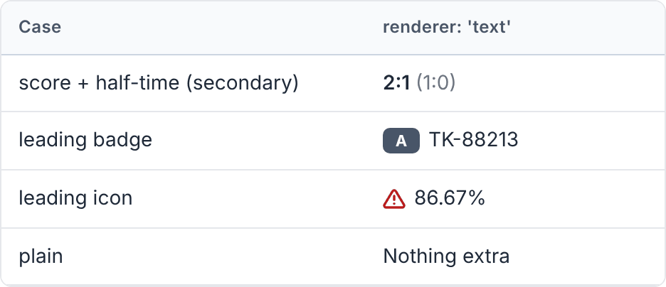<br>
<b><code>text</code></b> (default): text with optional extras.<br>
<sub><code>ellipsis</code> · <code>lines</code> · <code>tone</code> / <code>toneMode</code> · <code>bold</code> · <code>secondary</code> · <code>badge</code> · <code>icon</code> · <code>copyable</code> · <code>tooltip</code> · <code>placeholder</code></sub>
</td>
<td width="50%" valign="top">
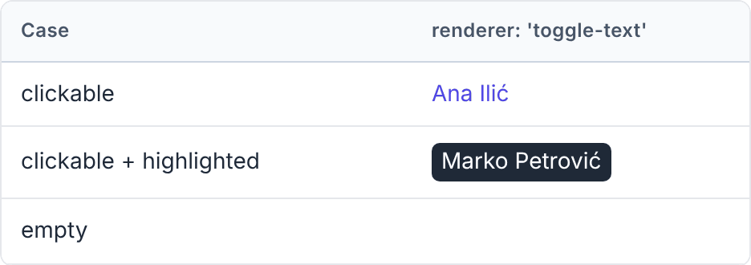<br>
<b><code>toggle-text</code></b>: text that toggles a highlight when clicked.<br>
<sub><code>clickable</code> · <code>highlighted</code> → emits <code>toggle</code></sub>
</td>
</tr>
<tr>
<td valign="top">
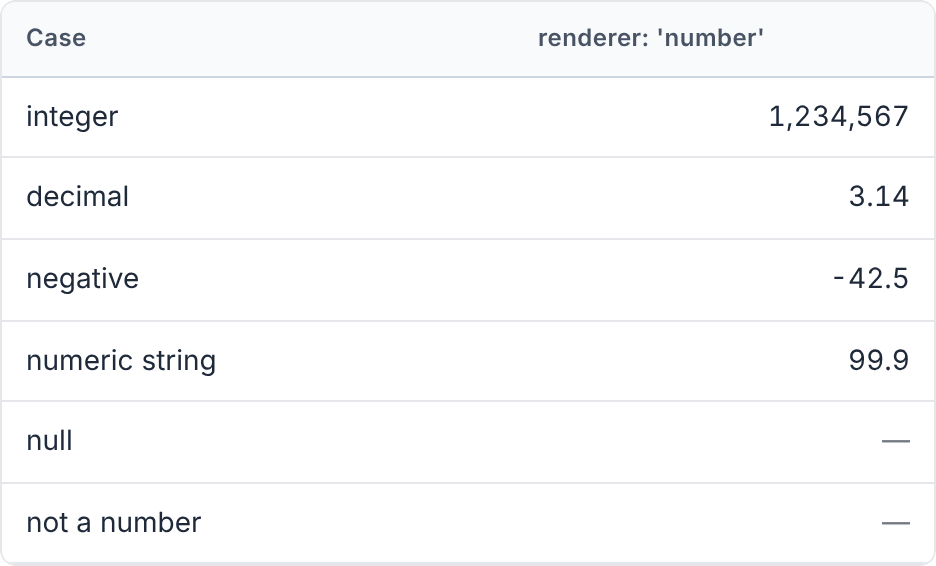<br>
<b><code>number</code></b>: locale-formatted numbers.<br>
<sub><code>format</code> (<code>Intl.NumberFormatOptions</code>) · <code>placeholder</code> · <code>clickable</code></sub>
</td>
<td valign="top">
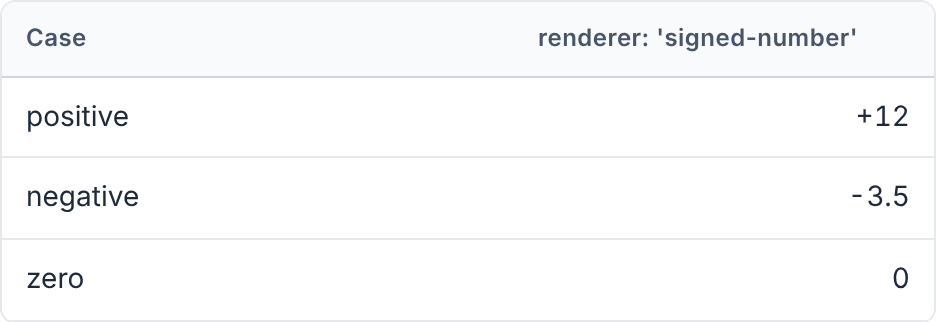<br>
<b><code>signed-number</code></b>: always shows the sign.<br>
<sub><code>format</code> · <code>placeholder</code> · <code>clickable</code></sub>
</td>
</tr>
<tr>
<td valign="top">
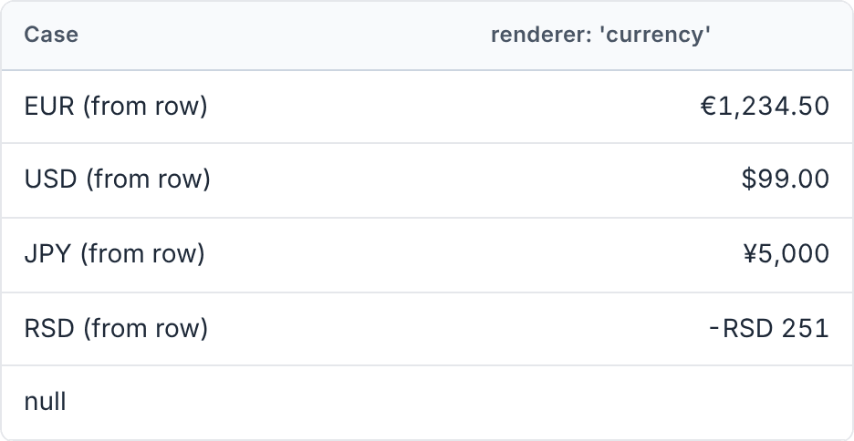<br>
<b><code>currency</code></b>: money in a fixed or per-row currency.<br>
<sub><code>currency</code> (code or <code>(value, row) =&gt; code</code>) · <code>format</code> · <code>placeholder</code> · <code>clickable</code></sub>
</td>
<td valign="top">
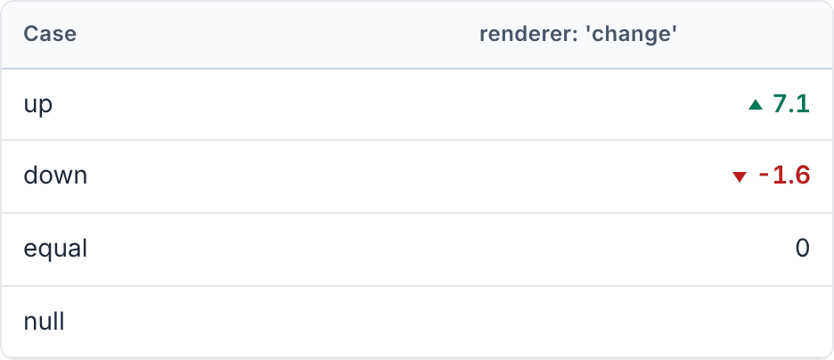<br>
<b><code>change</code></b>: a rise or fall, with arrow and colour.<br>
<sub><code>direction</code> · <code>currency</code> · <code>format</code> · <code>iconOnly</code></sub>
</td>
</tr>
</table>

#### Dates, state and labels

<table>
<tr>
<td width="50%" valign="top">
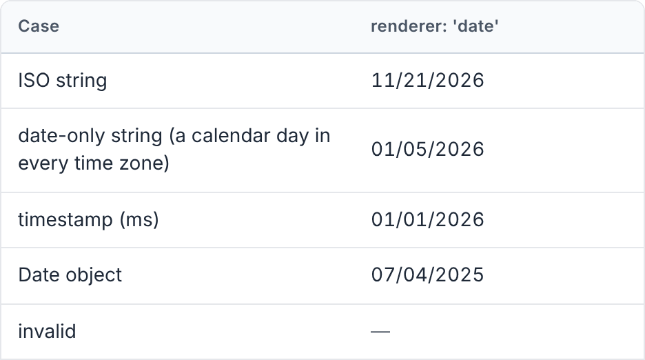<br>
<b><code>date</code></b>: a calendar day, in the grid's locale and time zone.<br>
<sub><code>format</code> (<code>Intl.DateTimeFormatOptions</code>) · <code>placeholder</code></sub>
</td>
<td width="50%" valign="top">
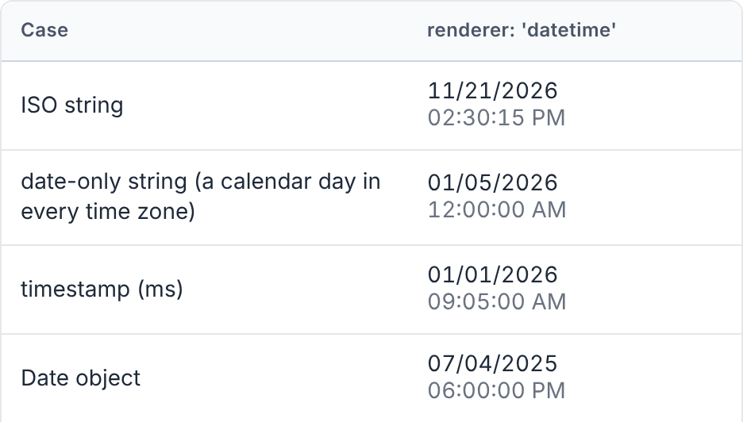<br>
<b><code>datetime</code></b>: date and time, on two lines by default.<br>
<sub><code>twoLines</code> · <code>milliseconds</code> · <code>format</code> · <code>placeholder</code></sub>
</td>
</tr>
<tr>
<td valign="top">
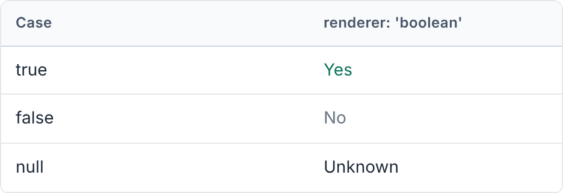<br>
<b><code>boolean</code></b>: yes / no as text or icons.<br>
<sub><code>trueLabel</code> · <code>falseLabel</code> · <code>nullLabel</code> · <code>display</code> (<code>text</code> / <code>icon</code>) · <code>falseIcon</code></sub>
</td>
<td valign="top">
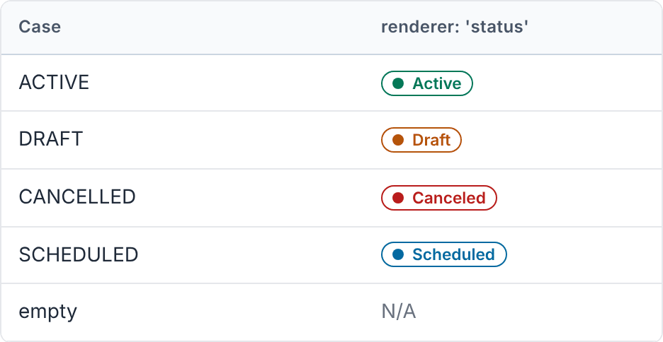<br>
<b><code>status</code></b>: a coloured status badge.<br>
<sub><code>tone</code> (map / fn / constant) · <code>label</code> · <code>dot</code> · <code>variant</code> (<code>soft</code> / <code>solid</code> / <code>outline</code>) · <code>clickable</code></sub>
</td>
</tr>
<tr>
<td valign="top">
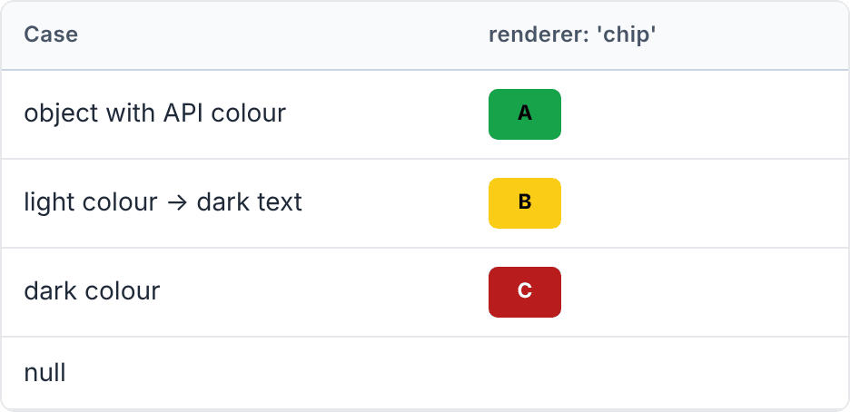<br>
<b><code>chip</code></b>: a chip in any colour, with readable text picked in CSS.<br>
<sub><code>color</code> · <code>tone</code> · <code>label</code> · <code>tooltip</code> · <code>shape</code> (<code>square</code> / <code>circle</code> / <code>pill</code>) · <code>size</code></sub>
</td>
<td valign="top">
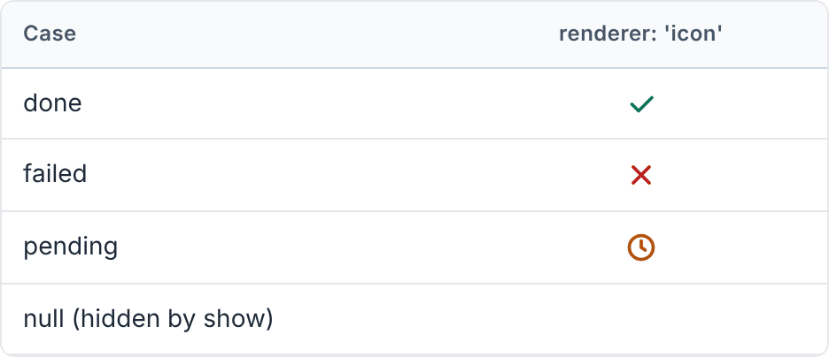<br>
<b><code>icon</code></b>: an icon from the value or a fixed one.<br>
<sub><code>icon</code> / <code>iconFor</code> · <code>show</code> · <code>label</code> · <code>tone</code></sub>
</td>
</tr>
</table>

#### Rich content

<table>
<tr>
<td width="50%" valign="top">
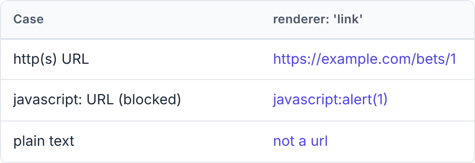<br>
<b><code>link</code></b>: safe links, or <code>&lt;RouterLink&gt;</code> with vue-router.<br>
<sub><code>href</code> · <code>to</code> · <code>label</code> · <code>target</code> · <code>tooltip</code></sub>
</td>
<td width="50%" valign="top">
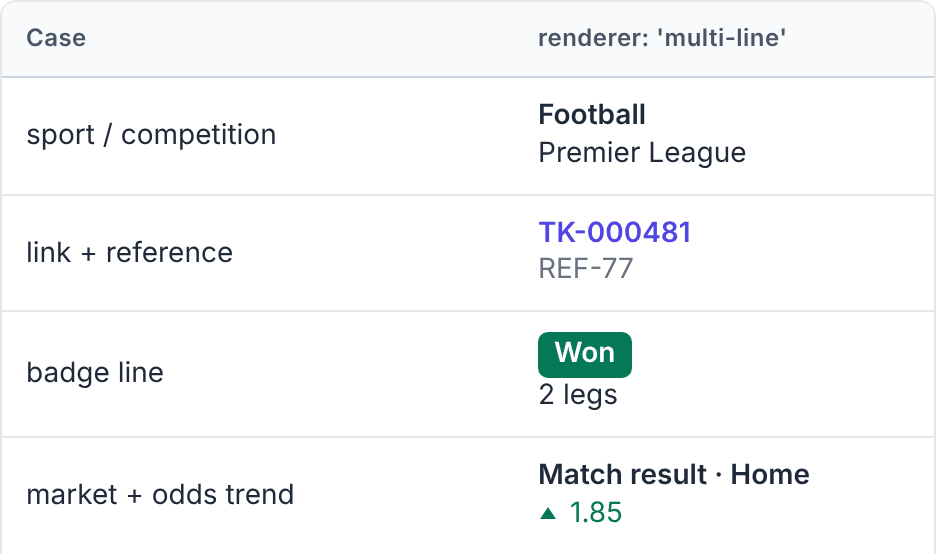<br>
<b><code>multi-line</code></b>: stacked lines, each with its own style, link, badge or trend.<br>
<sub><code>lines</code> · <code>boldLines</code> · <code>ellipsis</code> · <code>target</code>; per line: <code>text</code>, <code>href</code> / <code>to</code>, <code>tone</code>, <code>badge</code>, <code>trend</code>, <code>action</code></sub>
</td>
</tr>
<tr>
<td valign="top">
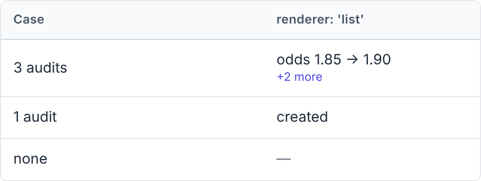<br>
<b><code>list</code></b>: the first items, with a “+N more” toggle.<br>
<sub><code>items</code> · <code>itemLabel</code> · <code>max</code> · <code>placeholder</code> → emits <code>expand</code></sub>
</td>
<td valign="top">
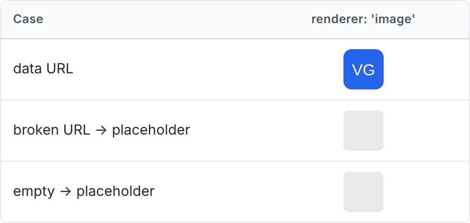<br>
<b><code>image</code></b>: thumbnails with a placeholder when empty or broken.<br>
<sub><code>src</code> · <code>baseUrl</code> · <code>alt</code> · <code>size</code> · <code>fit</code> · <code>shape</code></sub>
</td>
</tr>
<tr>
<td valign="top">
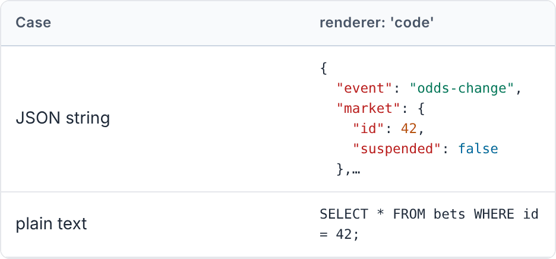<br>
<b><code>code</code></b>: monospaced code, with JSON highlighting.<br>
<sub><code>language</code> (<code>auto</code> / <code>json</code> / <code>text</code>) · <code>lines</code> · <code>indent</code> · <code>highlight</code></sub>
</td>
<td valign="top">
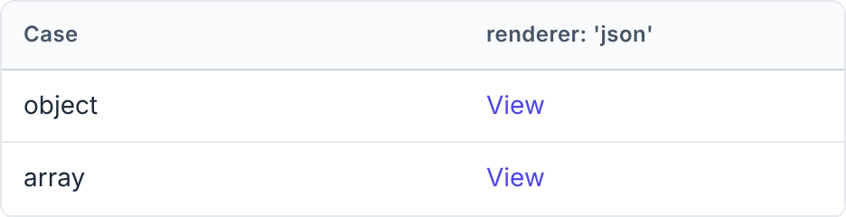<br>
<b><code>json</code></b>: a button that opens the JSON, escaped, in a dialog.<br>
<sub><code>label</code> · <code>dialogTitle</code></sub>
</td>
</tr>
<tr>
<td valign="top">
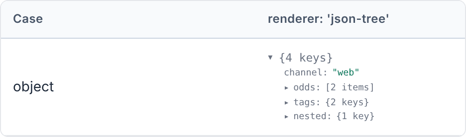<br>
<b><code>json-tree</code></b>: a collapsible tree of nested data.<br>
<sub><code>collapseAt</code> · <code>maxDepth</code> · <code>parseNested</code> · <code>collapsed</code> · <code>toggleLabel</code> · <code>emptyText</code></sub>
</td>
<td valign="top">
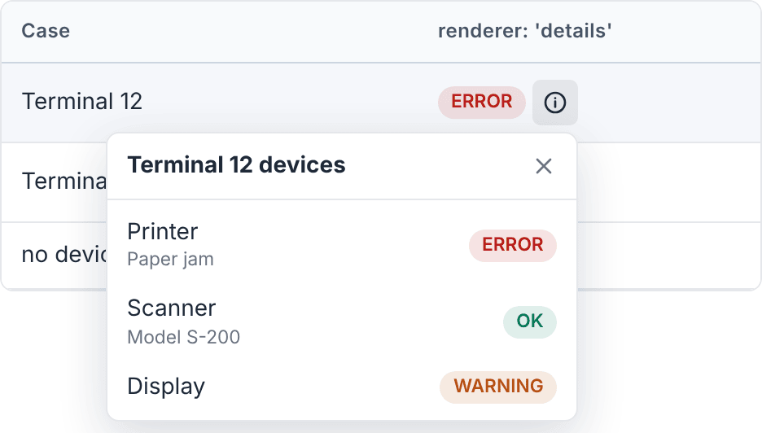<br>
<b><code>details</code></b>: a status badge plus an anchored info popover.<br>
<sub><code>tone</code> · <code>label</code> · <code>items</code> (<code>{ label, value, tone, detail }[]</code>) · <code>title</code> · <code>triggerLabel</code></sub>
</td>
</tr>
</table>

#### Actions and editing

Editable controls are *controlled*: they show your data and emit the requested change through
`@cell-action`, and your app updates the row.

<table>
<tr>
<td width="50%" valign="top">
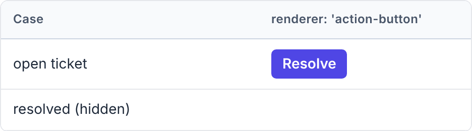<br>
<b><code>action-button</code></b>: one button per row.<br>
<sub><code>label</code> · <code>action</code> · <code>icon</code> · <code>tone</code> · <code>variant</code> (<code>outline</code> / <code>solid</code> / <code>ghost</code>) · <code>iconOnly</code> · <code>disabled</code> · <code>visible</code></sub>
</td>
<td width="50%" valign="top">
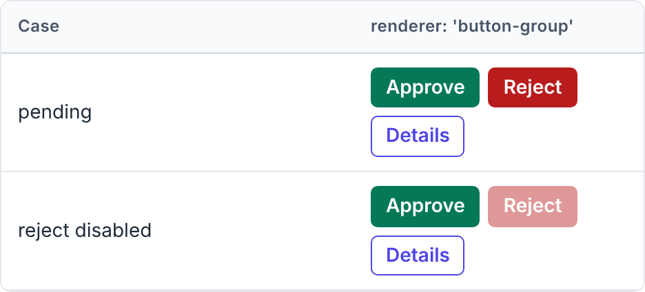<br>
<b><code>button-group</code></b>: several buttons, fixed or per row.<br>
<sub><code>buttons</code> (<code>{ name, label, tone, variant, icon, disabled, hidden }[]</code>) → emits the button's <code>name</code></sub>
</td>
</tr>
<tr>
<td valign="top">
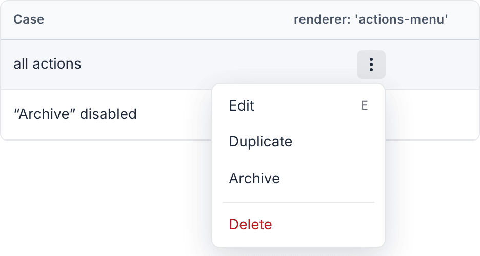<br>
<b><code>actions-menu</code></b>: a <code>⋯</code> menu, keyboard-friendly, anchored to its button.<br>
<sub><code>actions</code> (<code>MenuItem[]</code> or <code>(row) =&gt; MenuItem[]</code>) · <code>label</code> → emits the item's <code>name</code></sub>
</td>
<td valign="top">
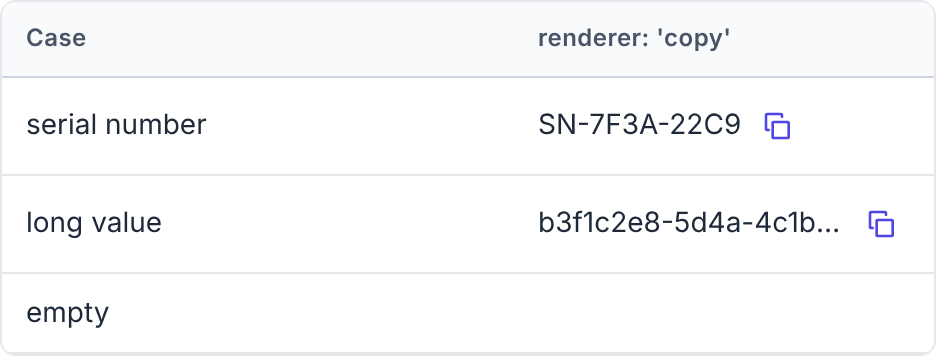<br>
<b><code>copy</code></b>: a value with a copy-to-clipboard button.<br>
<sub><code>copyValue</code> · <code>iconOnly</code> · <code>title</code> · <code>label</code> → emits <code>copy</code> / <code>copy-error</code></sub>
</td>
</tr>
<tr>
<td valign="top">
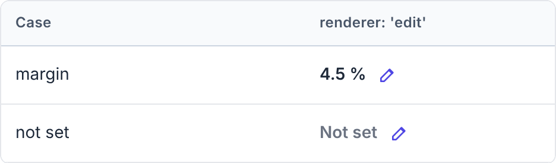<br>
<b><code>edit</code></b>: a value with an edit button, so your app can open its editor.<br>
<sub><code>format</code> · <code>label</code> · <code>disabled</code> · <code>bold</code> · <code>placeholder</code> → emits <code>edit</code></sub>
</td>
<td valign="top">
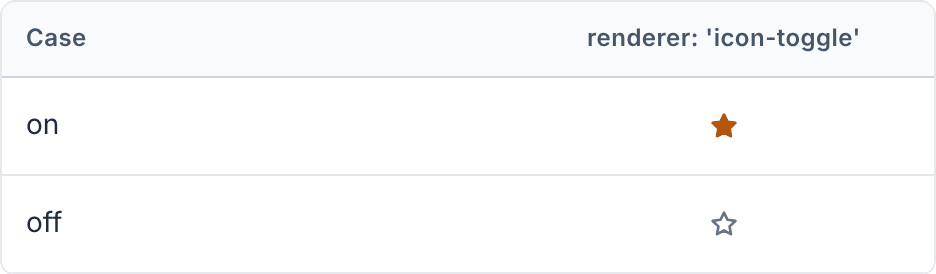<br>
<b><code>icon-toggle</code></b>: a star or flag style on / off button.<br>
<sub><code>active</code> · <code>icon</code> · <code>activeIcon</code> · <code>activeTone</code> · <code>label</code> · <code>disabled</code> → emits <code>toggle</code></sub>
</td>
</tr>
<tr>
<td valign="top">
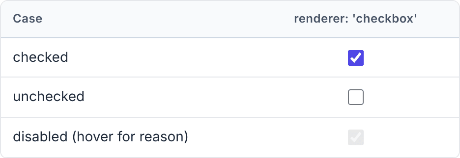<br>
<b><code>checkbox</code></b>: a checkbox, with a reason shown when disabled.<br>
<sub><code>checked</code> · <code>disabled</code> · <code>disabledReason</code> · <code>label</code> → emits <code>change</code></sub>
</td>
<td valign="top">
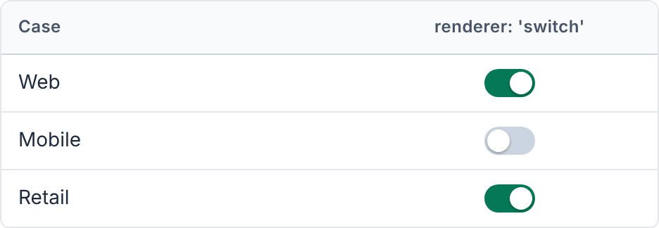<br>
<b><code>switch</code></b>: an on / off switch.<br>
<sub><code>checked</code> · <code>disabled</code> · <code>disabledReason</code> · <code>label</code> → emits <code>change</code></sub>
</td>
</tr>
<tr>
<td valign="top">
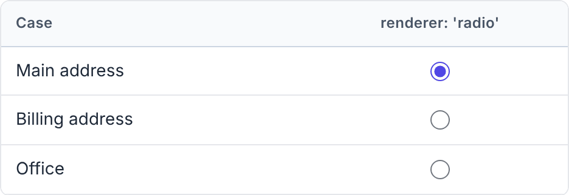<br>
<b><code>radio</code></b>: one selected row across the column.<br>
<sub><code>checked</code> · <code>disabled</code> · <code>disabledReason</code> · <code>label</code> · <code>name</code> → emits <code>select</code></sub>
</td>
<td valign="top">
<b>Your own renderer</b><br>
A component plus a three-line definition, with typed options and an optional sort value and
filter type. Copy the <a href="packages/cell-renderer-template">add-on template</a>, a
publishable star-rating renderer.
</td>
</tr>
</table>

## Quick start

```sh
npm i @eboye/vue-grid
```

Use it with a bundler (Vite, webpack, Rollup, esbuild): like Vue's `esm-bundler` build, it relies
on the bundler replacing `process.env.NODE_ENV`, which also strips its dev warnings from production
builds. See the [API reference](packages/vue-grid/README.md#install) for use without a build step.

```ts
// main.ts
import { createApp } from 'vue'
import '@eboye/vue-grid/style.css'
import App from './App.vue'

createApp(App).mount('#app')
```

```vue
<script setup lang="ts">
import { ref } from 'vue'
import {
  VGrid,
  createColumnHelper,
  currencyRenderer,
  columnPinningFeature,
  sortingFeature,
  statusRenderer,
  type SortState,
} from '@eboye/vue-grid'

interface Order { id: number; customer: string; total: number; status: 'Paid' | 'Open' }

const rows = ref<Order[]>([
  { id: 1, customer: 'Ana', total: 1234.5, status: 'Paid' },
  { id: 2, customer: 'Marko', total: 99, status: 'Open' },
])
const sort = ref<SortState | null>(null)

const col = createColumnHelper<Order>()
const columns = [
  col({ key: 'id', header: '#', width: 'min-content', pinned: 'left' }),
  col({ key: 'customer', header: 'Customer', width: '1fr', sortable: true }),
  col({
    key: 'total',
    header: 'Total',
    renderer: currencyRenderer, // renderers are opt-in: import only what you use
    rendererOptions: { currency: 'EUR' }, // typed against the renderer
    sortable: true,
  }),
  col({
    key: 'status',
    header: 'Status',
    renderer: statusRenderer,
    rendererOptions: { tone: { Paid: 'success', Open: 'info' } },
  }),
]
</script>

<template>
  <VGrid
    v-model:sort="sort"
    :rows="rows"
    :columns="columns"
    row-key="id"
    :features="[sortingFeature, columnPinningFeature]"
    sort-mode="client"
    style="height: 420px"
  />
</template>
```

Features are opt-in: list them per grid with `:features`, or once for the whole app with
`app.use(createVueGrid({ features: [sortingFeature, filteringFeature] }))` (`allFeatures` for
all of them). Without `sortingFeature`, `sortable` columns stay plain headers; without `columnPinningFeature`, `pinned` is ignored.

## Theming

```css
.brand-grid {
  --vg-color-accent: #db2777;
  --vg-color-header-bg: light-dark(#fdf2f8, #3b0a24);
  --vg-radius: 1rem;
  --vg-cell-padding-x: 1.25rem;
}
```

Set `color-scheme: light dark` on `html` to follow the OS, or `dark` to force it. Every token is
listed in the [API reference](packages/vue-grid/README.md#theming).

## Performance

The numbers below were measured in real browsers (Chromium and Firefox, driven by Playwright).
Ideas that measured no better were left out. `content-visibility`, for example, made scrolling
about 9× slower here and shifted column widths.

**Rendering only what's in view**

- Virtual scrolling (`virtualScrollingFeature`) renders the rows in view plus `overscan`, at every
  level of the tree. Off-screen siblings become spacers. Children stay inside their parent's CSS
  `subgrid`, so the DOM keeps the same structure as without virtual scrolling. *Expand all* on a
  14,000-row tree keeps about 24 rows in the DOM.
- Layout is one pass over the visible tree, run only when rows, expansion or measured heights
  change. Scrolling does a binary search per level, never a walk over all rows. On a 5,000-row
  expanded lazy tree, a fast fling causes no long tasks (over 50 ms).
- Detail rows of any height are measured as they render. The grid holds the first row in view in
  place while heights settle or children load above it, the same in every browser.
- Lazy children (`load-sub-rows`) are requested only for expanded rows in view, once a scroll
  settles. Flinging past 5,000 expanded rows sends about 40 requests instead of about 850.

**Updating only what changed**

- Partial updates re-render only the cells whose value changed. Use field assignments on reactive
  rows, or `patchRows` on immutable ones; unchanged rows keep their identity.
- The change highlight (`flash`) is an `opacity` fade on a layer under the text, which browsers run
  on the compositor (GPU). With 119 cells flashing for about 4 s, main-thread time dropped from about
  590 ms to about 90 ms.

**Filtering and sorting large data**

- Filters run as one pass over the row tree that produces the set of visible keys. Each level then
  filters in O(1) per row.
- Date filter on 10,000 rows: about 1.1 s → 12 ms (one cached formatter per time zone). Text filter
  and search on 100,000 rows: 66 ms → 16 ms (ASCII fast path, query folded once per filter).
  Value-list membership is a `Set` lookup.
- Value-list counts are memoised per column, so ticking values doesn't recount every row. Lists of
  thousands of values render their first 300.
- Sorting evaluates each row's sort value once (decorate–sort–undecorate) with one shared collator.
  `Intl` number and date formatters are cached and reused.

**Letting CSS do the work**

- Column alignment (`subgrid`), sticky headers and pins, menu placement (anchor positioning) and pin
  shadows (scroll-state container queries) are layout, not per-frame JavaScript. Where a browser
  lacks anchor positioning or scroll-state queries, a small fallback updates at most once per frame.
- Motion uses `transform` and `opacity`. Row highlights (hover, selection) appear at once and only
  fade out, so the grid responds the moment the pointer arrives.

**Shipping less**

- Every feature and renderer is opt-in and tree-shakeable. The filter popover, filter-row editors
  and pager load on demand.
- The published CSS is minified with Lightning CSS without transpiling, so modern CSS ships as
  written.

## Bundle size

Measured by bundling small apps against the published build for production with esbuild
(minified / gzip, Vue excluded):

| You import | Initial chunk |
|---|---|
| `VGrid` (no features) | 37.2 kB / 13.2 kB |
| `VGrid` + `sortingFeature` | 38.0 kB / 13.5 kB |
| `VGrid` + `filteringFeature` | 40.9 kB / 14.5 kB |
| `VGrid` + `selectionFeature` | 39.6 kB / 14.0 kB |
| `VGrid` + `subGridsFeature` | 39.5 kB / 14.0 kB |
| `VGrid` + `menusFeature` | 47.7 kB / 16.8 kB |
| `VGrid` + `columnReorderFeature` | 40.9 kB / 14.5 kB |
| `VGrid` + `columnPinningFeature` | 39.5 kB / 14.1 kB |
| `VGrid` + `virtualScrollingFeature` | 43.0 kB / 15.5 kB |
| `VGrid` + `columnVisibilityFeature` | 37.4 kB / 13.2 kB |
| `VGrid` + `keyboardNavigationFeature` | 39.6 kB / 14.0 kB |
| `VGrid` + `columnResizingFeature` | 40.1 kB / 14.3 kB |
| `VGrid` + `columnGroupsFeature` | 38.8 kB / 13.8 kB |
| `VGrid` + `rowPinningFeature` | 42.4 kB / 14.7 kB |
| `VGrid` + `aggregationFeature` | 42.7 kB / 14.8 kB |
| `VGrid` + `allFeatures` + `VGridSearch` | 81.0 kB / 28.1 kB |
| `VGrid` + `currencyRenderer` | 38.5 kB / 13.6 kB |
| everything | 124.1 kB / 40.4 kB |
| `validateGridConfig` (`@eboye/vue-grid/agent`, never in an app bundle) | 57.5 kB / 15.4 kB |

With `filteringFeature`, the filter popover body and the filter-row editors load on demand. With
`paginationFeature`, the pager does too.

CSS (minified with Lightning CSS): `style.css` has everything (6.5 kB gzip). The default theme is optional too: `base.css`
(2.2 kB) is the structure alone, `theme.css` (3.2 kB) the look on top of it, and `renderers.css`
(2.2 kB) the cell renderers. Import only `base.css` to theme the grid from scratch.

## Browser support

Current Chrome / Edge and Firefox — both covered by the automated browser tests — and Safari
(same baseline, not yet in the automated tests). The baseline is CSS `subgrid`, `@layer`,
`light-dark()` and the Popover API.
Newer CSS — anchor positioning, `position-visibility`, scroll-state container queries,
`contrast-color()` — is used where available, with small JavaScript fallbacks elsewhere. The full
matrix is in the [API reference](packages/vue-grid/README.md#browser-support).

## Documentation

| Resource | What it covers |
|---|---|
| [Examples cookbook](docs/examples.md) | Task-by-task guide with copy-paste snippets for every feature |
| [API reference](packages/vue-grid/README.md) | Props, events, slots, column options, every renderer option, CSS tokens |
| **Storybook** — `npm run storybook` | A story per feature and per renderer, live controls, generated prop tables, dark mode |
| **Playground** — `npm run dev` | Every feature on one page |
| [Add-on template](packages/cell-renderer-template) | A publishable third-party renderer (star rating) to copy |
| [AGENTS.md](packages/vue-grid/AGENTS.md) | The guide for coding agents: rules, feature / renderer choice, recipes, pitfalls |

## For coding agents

The grid is built to be used correctly by AI coding agents (Claude Code, Cursor, Copilot…), not
only by people reading docs. Everything an agent needs ships in the package and is generated
from the sources, so it can't drift from the code:

- **[`AGENTS.md`](packages/vue-grid/AGENTS.md)** — the rules whose omission causes silent bugs
  (register features, pass renderer definitions, `sort-mode="client"`, a bounded height), which
  feature and renderer to use for what, recipes and pitfalls.
- **[`llms.txt`](packages/vue-grid/llms.txt) / `llms-full.txt`** — the [llms.txt](https://llmstxt.org)
  index, and the guide + API reference + README in one file.
- **[API reference](packages/vue-grid/agent/api.md)** and **`agent/api.json`** — every prop,
  v-model, event, slot, method, column option, feature and renderer option, with types, docs and
  the feature each needs.
- **[JSON Schema](packages/vue-grid/agent/grid-config.schema.json)** of a grid config, and
  **`validateGridConfig()`** from `@eboye/vue-grid/agent`: unknown names with did-you-mean, options
  whose feature is missing, unregistered renderers, wrong types, combinations that do nothing —
  each with its fix.
- **[MCP server](packages/vue-grid-mcp)** — `npx -y @eboye/vue-grid-mcp`: guide, API lookup,
  renderer details, doc search and validation as tools, from the project's installed version.
- **[Claude Code plugin](plugins/vue-grid)** — the MCP server plus a `vue-grid` skill with the
  build → validate → verify-in-a-browser workflow:

  ```
  /plugin install vue-grid --marketplace https://github.com/eboye/eboye-vue-grid
  ```

## Development

```sh
npm install
npm run dev              # playground → http://localhost:5180
npm run storybook        # Storybook  → http://localhost:6006
npm test                 # unit tests (Vitest)
npm run typecheck && npm run lint
npm run build            # both packages → dist/
npm run e2e              # browser tests, Chromium + Firefox (first time: npx playwright install chromium firefox)
npm run e2e:storybook    # every story renders without errors; interactive renderers with real input
npm run showcase         # re-record docs/media/showcase.* (needs dev + Storybook running, and ffmpeg)
npm run screenshots      # re-shoot the renderer gallery → docs/media/renderers (needs Storybook running)
```

<details>
<summary>Repository layout</summary>

| Path | |
|---|---|
| [`packages/vue-grid`](packages/vue-grid) | The library, `@eboye/vue-grid` |
| [`packages/cell-renderer-template`](packages/cell-renderer-template) | Boilerplate third-party renderer add-on |
| `stories/`, `.storybook/` | Storybook |
| `playground/` | Demo app; target of the browser tests |
| `e2e/` | Playwright tests driving the playground and Storybook with real mouse and keyboard |
| `docs/` | Examples cookbook, showcase media, renderer screenshots, design notes |
| `scripts/` | Showcase recorder, renderer gallery screenshots |

</details>

### Publishing

```sh
npm run build
npm publish -w @eboye/vue-grid --access public
npm publish -w @eboye/vue-grid-renderer-template --access public
```

## License

MIT
